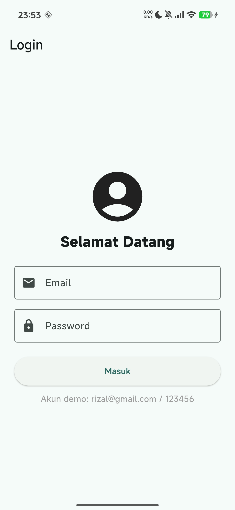
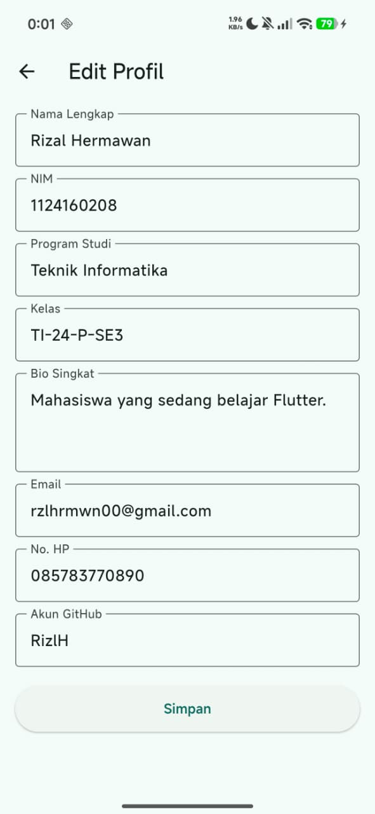
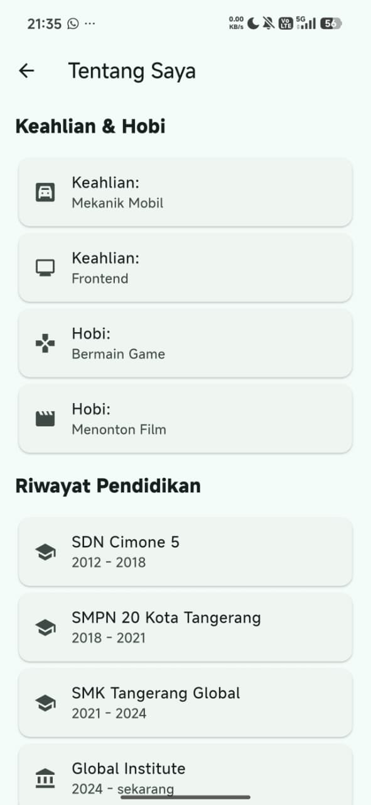

# Aplikasi Profil Soal-2 (Flutter)

## Identitas
 Nama: Rizal Hermawan <br>
 NIM: 1124160208 <br>
 Kelas: TI 24 P SE 3 <br>
 Mata Kuliah:  Aplikasi Mobile (UTS) 

## Link Video YouTube

https://youtu.be/6k_9hjMB5tM?si=DXAPzeCPkWdYWDJa

## Screenshot

<table align="center">
  <tr>
    <td align="center"><b>Login</b></td>
    <td align="center"><b>Profil (Terang)</b></td>
    <td align="center"><b>Profil (Gelap)</b></td>
  </tr>
  <tr>
    <td></td>
    <td></td>
    <td></td>
  </tr>
  <tr>
    <td align="center"><b>Edit Profil</b></td>
    <td align="center"><b>Tentang Saya</b></td>
    <td align="center"><b>Menu Samping </b></td>
  </tr>
  <tr>
    <td></td>
    <td></td>
    <td></td>
  </tr>
</table>

## Daftar Fitur

1. **Halaman Login**: form dengan validator (email dan password), loading, cek akun, dan pindah halaman memakai `pushReplacement`.
2. **Halaman Profil**: foto dengan `CircleAvatar`, nama, NIM, program studi, kelas, bio singkat, dan kontak (email, nomor HP, akun GitHub) memakai `Card` + `ListTile` dengan ikon.
3. **Halaman Edit Profil**: form berisi data profil saat ini (nilai awal dari `TextEditingController`), validasi (nama wajib diisi, email valid, nomor HP hanya angka 10-13 digit), dan tombol Simpan yang mengirim data baru ke halaman Profil dengan `Navigator.pop`. Halaman Profil langsung menampilkan data baru lewat `setState()`.
4. **Halaman Tentang Saya**: keahlian/hobi dan riwayat pendidikan ditampilkan dengan `ListView`.
5. **Scaffold lengkap**: `AppBar`, `drawer`, dan `floatingActionButton`.
6. **Tema**: tema terang dan gelap dengan warna sendiri, dengan tombol/switch mode gelap yang mengubah `themeMode` secara langsung.

## Cara Menjalankan

```bash
flutter pub get
flutter run
```

Akun untuk login: `rizal@gmail.com` / `123456`

## Download APK

[Download Apk Profil Rizal disini](https://github.com/RizlH/uts-pml-1124160208/releases/tag/v1.0.0)